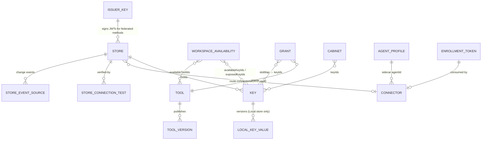

# Keyhole collections (Mongo database `keyhole`)

Validators and indexes are in `indexes.json`. To generate the mongosh script:

```sh
python3 ../shared/tools/mongo_validator.py --indexes indexes.json
```



| Collection | Schema | Holds | Written by | Invariants / notes |
|---|---|---|---|---|
| `stores` | `store.schema.json` | Org-level secret stores, discriminated by `provider`, with `auth` discriminated by `method` | org admins | Only secretRefs. A connector-only method, `identitySource: connector_ambient`, or `networkExposure: private` requires `route.mode: connector`. See `stores.md`. |
| `keys` | `key.schema.json` | Where a value lives (provider-specific `address`) and its cache TTL | org admins (workspace admins only for cabinet keys in their workspace) | Never the value. `pinned` is derived from the address. |
| `local_key_values` | `local_key_value.schema.json` | Local-store values, one row per version, envelope-encrypted | the broker's key-write path | The only secret values in this database. A separate DB role: only the key-resolution service reads it, and no admin API returns it. |
| `tools`, `tool_versions` | `tool…` | The draft, and immutable published snapshots | org admins | Grants use published versions only. |
| `grants` | `grant.schema.json` | A tool granted to a workspace, with slot → key | workspace admins (within availability) | `toolId ∈ availableToolIds`; every mapped key ∈ `exposedKeyIds`; `keyIds` is derived for the index. |
| `workspace_availability` | `workspace_availability.schema.json` | `availableKeyIds`, `availableToolIds` (org admins); `exposedKeyIds` (workspace admins) | see column | `exposedKeyIds ⊆ availableKeyIds`. Narrowing availability un-exposes keys and removes grants in the same transaction, with an impact preview. |
| `workspace_settings` | `workspace_settings.schema.json` | Slug, HTTPS/MCP on | workspace admins | |
| `cabinets` | `cabinet.schema.json` | A workspace-scoped key and tool bundle, with its access list | workspace members (create); manager or workspace admins (manage) | `managedBy` falls back to null (workspace admins) when the manager can no longer use the workspace. |
| `agent_profiles` | `agent_profile.schema.json` | Keyhole status, the `kh_live_` token, expiry, rate limit | org admins | Token lookup via `token_hash` / `token_hash_prev` (global auth-path indexes). |
| `connectors` | `connector.schema.json` | Vault connectors and sidecars | see permissions below | Presence lives in Redis; this row is written on transitions. |
| `enrollment_tokens` | `enrollment_token.schema.json` | Single-use `kh_enr_` records, and the intent they carry | admins | Consumed atomically; TTL 30 days after expiry. |
| `store_connection_tests` | `store_connection_test.schema.json` | Every verify run, step by step | system | Never contains values; TTL 30 days. |
| `store_event_sources` | `store_event_source.schema.json` | Vendor change-event hooks and subscriptions | org admins | Events are hints; Keyhole re-reads. |
| `issuer_keys` | `issuer_key.schema.json` | Keyhole-as-issuer signing keys | platform | Private keys stay in the KMS. |
| `org_settings` | `org_settings.schema.json` | Notifications, alert webhook, `configVersion` | org admins, system | |
| `audit_events` | `../shared/audit_event.schema.json` + `audit_detail.schema.json` | Keyhole-only rows (requests, blocks, errors, connection, verification, Keyhole admin consequences) | everything | IDs only; never values or bodies. |
| `applied_events` | `../shared/applied_event.schema.json` | Projector idempotency | projector | TTL 14 days. |

## Permission boundaries the data enforces (PR #20 review)

| Action | Org admin | Workspace admin (own workspace) |
|---|---|---|
| Make keys or tools **available** to a workspace (`availableKeyIds`, `availableToolIds`) | yes | no |
| **Expose** an available key; **grant** an available tool; slots and limits | yes | yes |
| Create keys, tools, stores; route a store through a connector | yes | no |
| Add an org agent that is **not already in the workspace**, or bind a sidecar to one | yes | no. A workspace admin binds sidecars only to agents already in the workspace. |
| Rename, rotate, rebind or revoke a **vault connector** that routes an org store (`routesStoreIds` non-empty, `scope: org`) | yes | no; read-only |
| The same for a sidecar, or a vault connector that routes nothing | yes | yes |
| Receive a rotated connector credential | only for components they can manage | same |

The API checks these at action time against `suite.workspace_memberships`, `workspace_availability` and `connectors.routesStoreIds` (rule 3). The UI copy must say what a workspace admin can reach.

## Component lifecycle (vault connectors and sidecars)

1. **Create an enrollment token.**
   - The admin picks the kind, name, workspace, agent (sidecar), listen address, exposure, local auth, mode and cache policy.
   - The server stores `enrollment_tokens` with the token digest and that `intent`, and shows `kh_enr_…` once.
   - It expires in 15 minutes.
2. **Install and enroll** (`cli.md`). On the host:
   - `keyhole connector install` (or `sidecar install`), then `enroll`, which reads the token from stdin, a file or an env var, never argv;
   - generate an X25519 keypair (and an mTLS CSR when enabled);
   - call `POST /v1/components/enroll` with the token and public key.
3. **Consume the token.** In one transaction the server:
   - consumes the token: `findOneAndUpdate({token.hash, status: pending, expiresAt > now}, {status: consumed, …})`;
   - inserts the `connectors` row with `enrollment` and `credential.current`;
   - writes the audit row.

   The response carries `kh_conn_…` or `kh_sc_…`, the intent, the cache policy and the org `configVersion`. A sidecar with caller-token auth also gets `kh_call_…`, shown to the admin once in the UI (and printed once by the CLI), never logged.
4. **Run.** The component opens an outbound WSS tunnel to the gateway: presence and heartbeats every 15 s, config sync by `configVersion`, and the invalidation stream.
5. **Rotate** (`POST /v1/components/{id}/rotate {graceSeconds}`), by an admin or by the component with its current credential. It applies the `credentialSet` rule: at most one previous credential; a rotation during grace ends the earlier grace now; `graceSeconds: 0` stops the old one at once. "End grace now" is `POST …/end-grace`.
   - **Online component:** the new credential is sealed to its public key and pushed down the tunnel.
   - **Offline component:** the credential is shown once; paste it with `keyhole connector credential set` (stdin). The UI must not say "the running connector picks it up".
6. **Revoke.** `status: revoked`, credential cleared. The server sends a `wipe` control message: the component deletes its cache, zeroes its keys and exits (`cache.md` §5). A revoked component that is offline wipes when it next connects and gets `401 component_revoked`.

## Sidecar settings (from the in-flight PR #20 fixes)

| Setting | Field | Rule |
|---|---|---|
| Listen address | `local.listen` | Loopback TCP by default (`127.0.0.1:8787`), or a unix socket (`/run/keyholed/<name>.sock`, mode 0660). |
| Expose on network | `local.exposeOnNetwork` + `exposureAcknowledged` | Off by default. On, the host may be non-loopback; this needs an acknowledgement and forces caller-token auth. |
| Local-caller auth | `local.localAuth` | `unix_socket` (file permissions) or `caller_token` (`kh_call_…`, required for any TCP address). The caller token's digest reaches the sidecar in its config sync; the sidecar compares locally. |
| Mode | `appMode` | `base_url` (`http://127.0.0.1:8787/<tool>/…`, no CA) or `proxy` (HTTP(S)_PROXY; HTTPS needs the sidecar's local CA, whose fingerprint is `proxy.localCaFingerprint`). Proxy mode refuses hosts outside `proxy.allowedHosts`. |
| Enrollment token | `enrollment_tokens` | Single use, 15 minutes, never on argv. |
| Cache | `cachePolicy` | See `cache.md`. |
